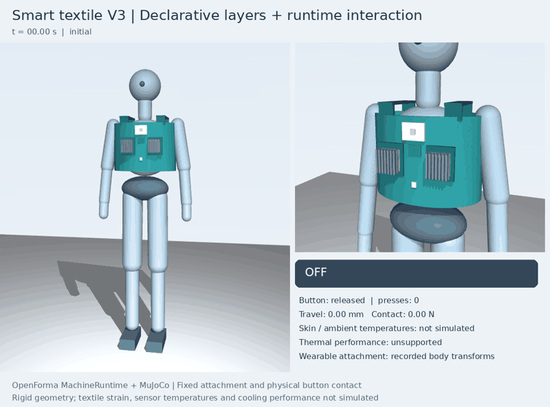
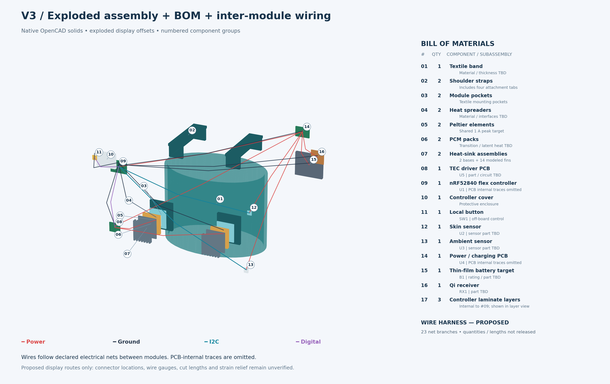
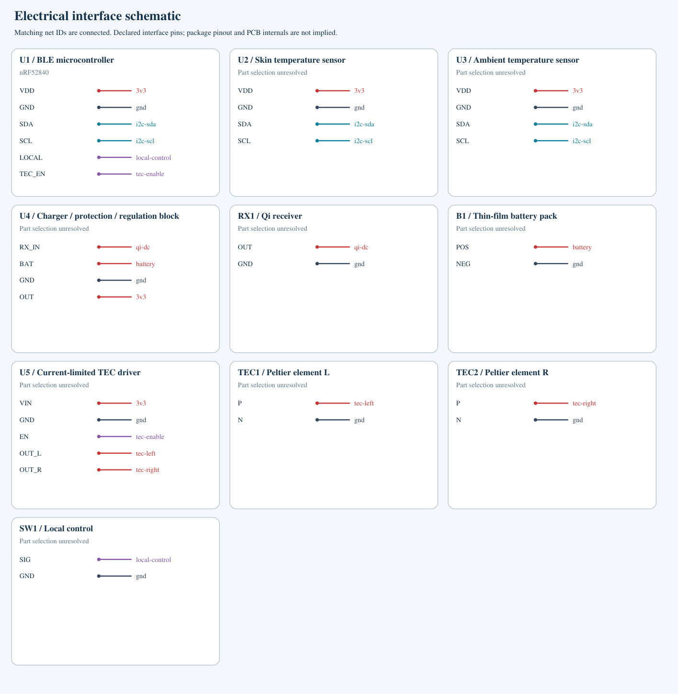

# Smart textile V3 — Mapped-Assembly showcase

Benchmark: https://github.com/caid-technologies/Form/issues/283

[Download the evidence package](smart-textile-v3-evidence.zip?raw=true): declarative JSONs, STEP geometry, OBJ assets, source patches, reproduction script, recorded runtime trace, renders and verification receipts.

The original run recorded 351 states over 14 seconds through OpenForma MachineRuntime and MuJoCo. The preview is resized and samples every fifth recorded frame while preserving duration. The archive uses this preview in place of the original 38 MB GIF; original GIF hashes in recovered receipts refer to the original, not this preview. Other recovered files are preserved. Historical no-publication statements in VERIFICATION.md describe the original checkpoint before this artifact publication.

The recovered checks record 164 passing tests and seven optional skips. These were not rerun for publication. Demonstrates architecture validation, CAD and simulated contact-driven control; cooling, cloth deformation, electrical feasibility, firmware, BLE/Qi and human-use safety remain unverified. See VERIFICATION.md and issue-evidence/gaps.json.
