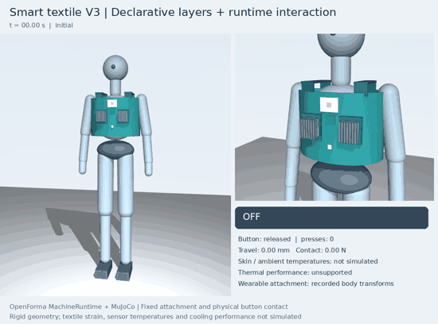
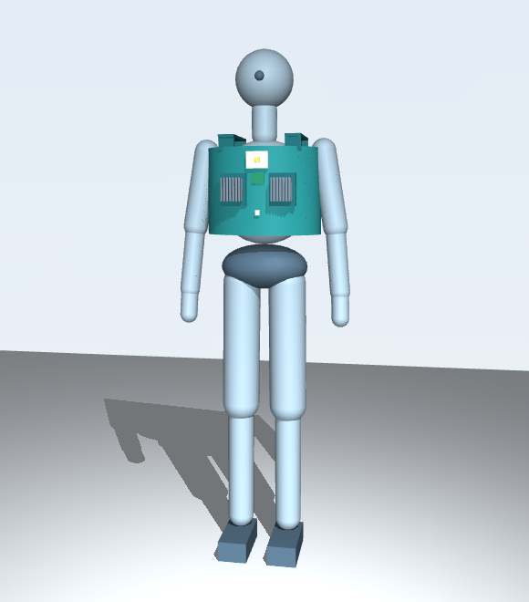
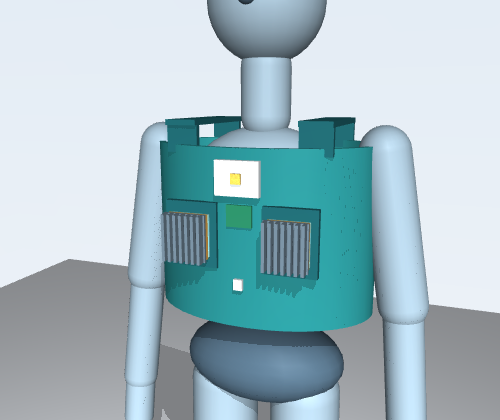
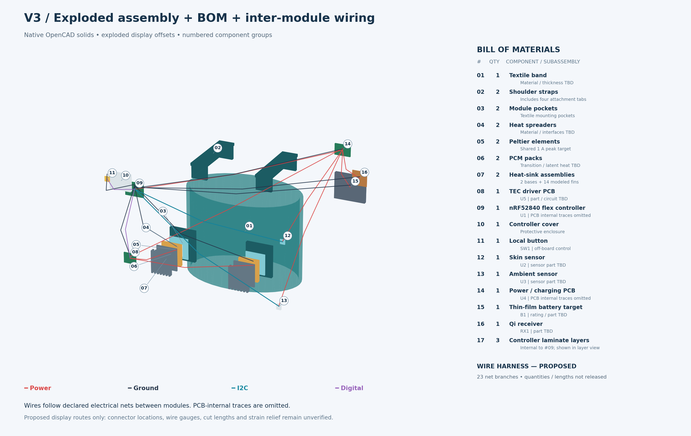
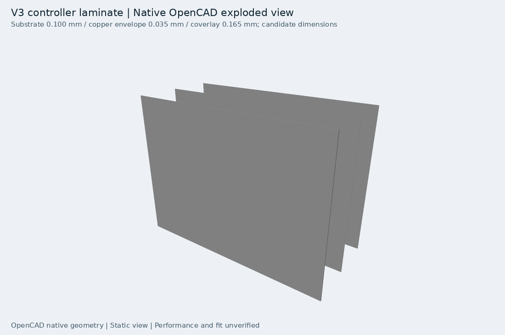
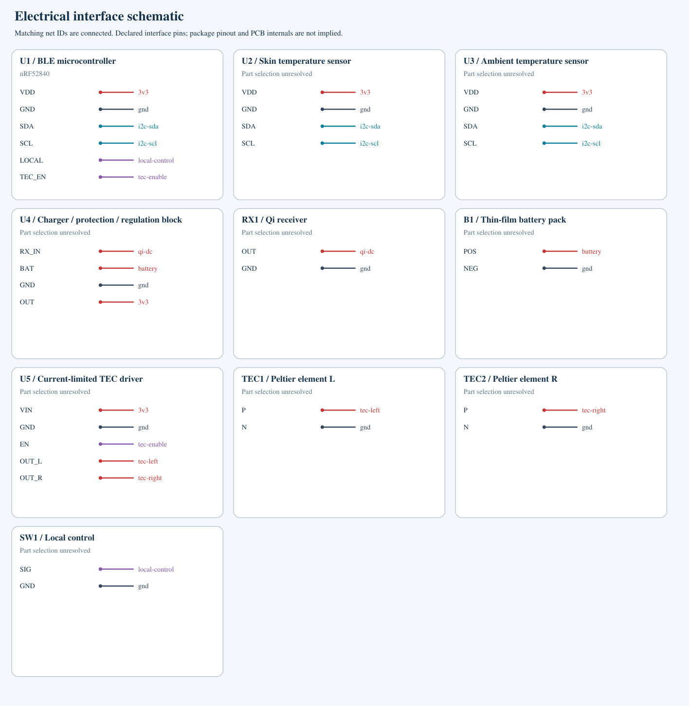

# Smart textile V3 — generated benchmark artifacts

Evidence for [caid-technologies/Form#283](https://github.com/caid-technologies/Form/issues/283).
This branch publishes generated artifacts only; it does not change OpenForma's
active source or claim to fix the original CAID deployment.

[Download engineering package (smaller GIF preview)](smart_textile_v3.zip?raw=true) ·
[Verification report](v3/VERIFICATION.md) ·
[Exact remaining gaps](v3/issue-evidence/gaps.json)

## Declarative JSON inputs

- [System architecture](v3/issue-evidence/system-architecture.json)
- [Requirements](v3/requirements.json)
- [Product bundle and pinned cross-domain relationships](v3/product-bundle.json)
- [HumanIR](v3/human.json), [MechanicalIR](v3/mechanical.json), [ElectricalIR](v3/electrical.json), [ThermalIR](v3/thermal.json)
- [Geometry](v3/geometry.json), [laminate geometry](v3/layer-geometry.json)
- [MuJoCo adapter configuration](v3/configuration.json), [interaction sequence](v3/interaction.json), [render views](v3/views.json)
- [Recorded execution states](v3/runtime-trace.json), [OpenIndustries scene](v3/smart-textile-v3.oi.json)
- [Verification results](v3/verification.json), [native domain checks](v3/engineering-verification.json)

## Engineering assets

- [Device STEP](v3/device-opencad.step?raw=true), [human + device STEP](v3/wearer-and-device-opencad.step?raw=true)
- [Native mesh assets](v3/assets)
- [BOM](v3/bom.csv), [external wire list](v3/external-wires.csv)
- [Electrical interface SVG](v3/issue-evidence/electrical-interface.svg)
- [Source changes as a portable patch](v3/openforma-v3.patch), [reproduction script](reproduce_v3.sh)
- [File hashes](v3/artifact-sha256.json)

## Executed interaction

14 seconds; 351 recorded states. Arm/torso motion and two contact-driven button
presses use OpenForma MachineRuntime and its MuJoCo adapter. This GIF is rendered
from executed states, not manually animated poses.

## Full body and device

## Exploded assembly, BOM and proposed external wiring

## Scope

164 relevant tests passed; seven optional tests skipped. Geometry, declarations
and simulated interaction have evidence. Cloth deformation, component-level
circuit design, manufactured harness routing, battery feasibility, firmware/BLE/Qi
execution and coupled TEC/PCM thermal feedback remain unresolved. The button toggles
a virtual cooling request; it does not prove cooling. No thermal measurements or
predictions have been fabricated. Original hardware requirements remain unchanged.

The download replaces the original full-resolution GIF with a 550×408 preview retaining all 351 frames and timing. All original declarative JSON, geometry and execution states are included. See [preview provenance](v3/preview-provenance.json); the reproduction script regenerates the original full-resolution GIF.
