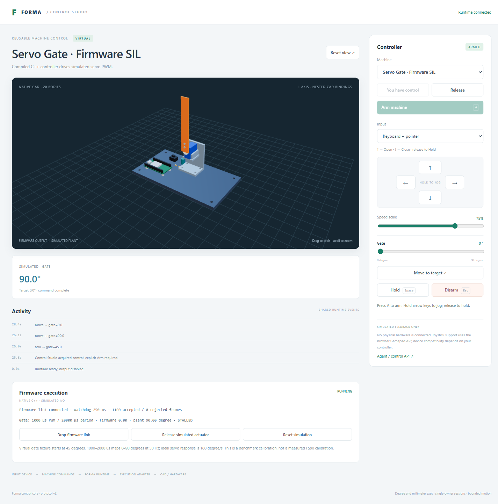
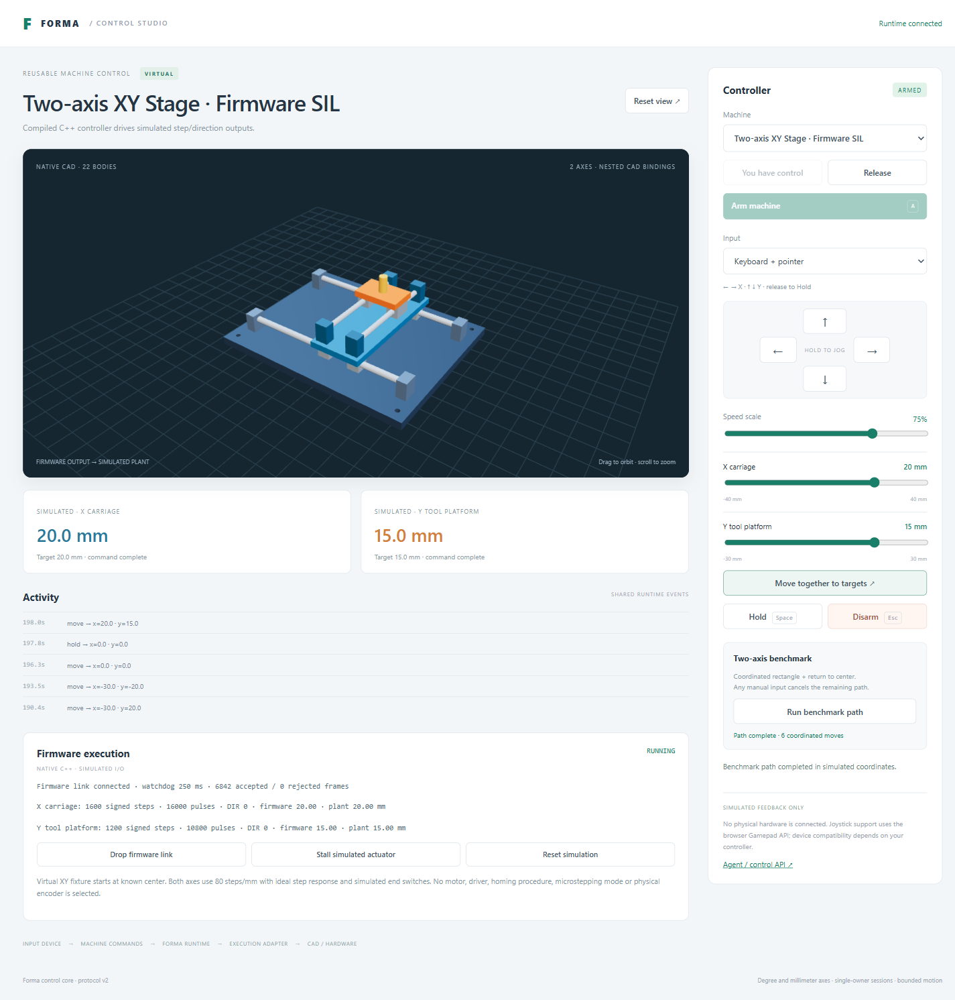

# Firmware software-in-the-loop

The control examples can now execute **compiled, portable C++ controller code**
on the host through `forma_core.firmware.sil`. The controller parses serial-style
frames, enforces limits/rates, drives a hardware-abstraction interface and owns
a local communications watchdog. A native simulated-I/O implementation turns
those outputs into virtual mechanism positions.

Control Studio offers four machines when the native library is built:

- Servo Gate — ideal kinematics.
- Servo Gate · Firmware SIL — compiled servo controller and simulated servo.
- Two-axis XY Stage — ideal kinematics.
- Two-axis XY Stage · Firmware SIL — compiled step/direction controller and
  simulated linear axes/end switches.

The initial selection is the firmware gate. Each entry has independent control
ownership, planner, firmware state and virtual fixture. They share mesh assets,
axis definitions, keyboard/gamepad handling and the protocol-v2 agent API.

## Studio screenshots

The gate below is deliberately stalled at 90 degrees while its firmware commands
0 degrees; the simulated readout and CAD retain the plant position.





[Mobile layout](images/control-studio-firmware-mobile.png) ·
[Studio before the firmware panel](images/control-studio-before.png)

## Build and run

Requires CMake 3.20+, a C++17 compiler and the normal example dependencies.
Visual Studio 2022 C++ tools were already installed on this Windows checkout;
the implementation was built with MSVC 19.43. No compiler was downloaded.

From the repository root, in the project Python environment:

```sh
python -m forma_core.firmware.sil.build --output examples/control_studio/generated/firmware
cd examples/control_studio
npm ci
npm run build
python server.py --port 8766
```

Stop the studio before rebuilding a loaded native library (particularly on
Windows). Restart it afterward. `launch.py` opens an existing server rather than
upgrading/restarting it. A build manifest records the normalized source hash and
library hash; the adapter rejects stale or mismatched builds. A clean checkout
without the optional library offers the two ideal machines only. Native source
and CMake files are included in the Python package; compiled libraries are local
generated artifacts, not checked-in executables.

## Execution boundaries

1. The existing Python runtime owns sessions, protocol-v2 validation and
   coordinated trajectory planning. It samples absolute named-axis setpoints.
2. `FirmwareSilAdapter` serializes those samples to the native controller.
3. `Controller` parses and validates each entire frame, enforces a separate local
   rate cap and sends servo/step commands through `IO` in `controller.h`.
4. `bridge.cpp` provides simulated GPIO/timer-level operations and idealized
   mechanism response. It reports plant position independently of the firmware's
   own commanded position/step counter.
5. The adapter reports **simulated** feedback. The SIL viewer follows this
   feedback, never the runtime's commanded coordinate. Physical measurement
   stays null.

`controller.h` / `controller.cpp` are the portable firmware logic. The ctypes
bridge, Python adapter and simulated plant are desktop test infrastructure.
A future board port must implement the same I/O and clock interface with actual
timers, GPIO and serial reads and supply a board build/entrypoint. This does not
execute the older generated Arduino scaffold or an ESP32 firmware image.

### Wire protocol within the simulator

The high-level public API remains protocol v2. The internal firmware link is a
different bounded, newline-delimited protocol:

```text
F1 <increasing-sequence> <enabled:0|1> <axis-count> <axis-0-setpoint> ...\n
```

Axis order comes from the machine definition/profile, units remain degrees/mm,
and every frame must cover all axes. Values must be finite and in range.
Sequences are nonnegative integers up to `2^53-1`; enable is exactly 0 or 1.
Incomplete frames have no effect. Bad counts/fields, extra tokens, embedded NULs,
out-of-range values and stale sequences are rejected atomically. A 512-byte
bounded line buffer discards overlong frames through the next newline. Invalid
frames do not refresh the watchdog. This is an in-process simulated link, not a
production serial transport with baud-rate/error/CRC modeling.

### Time and watchdogs

Firmware receives an explicit monotonic millisecond clock. Tests advance a
virtual clock; the studio supplies elapsed host monotonic time. Integration is
capped at 20 ms per tick and does not catch up after a scheduling delay.

The **250 ms firmware watchdog** monitors valid setpoint frames from the host
adapter. It disables outputs and latches a firmware fault before advancing motion
when expired. This is separate from the runtime's **1000 ms user/agent command
watchdog**, which holds the host plan on lost input traffic while the host can
still communicate with firmware.

Watchdog execution in SIL is cooperative: the simulator must be ticked to observe
elapsed time. The library is not an independent MCU that continues running when
the entire host process is suspended or killed. This validates timeout logic and
failure handling, not an independent real-time hardware watchdog or wall-clock
scheduling guarantees.

## Simulated hardware assumptions

Profiles are explicit sidecars in `examples/control_studio/profiles/`.

| Fixture | Assumed output/response |
|---|---|
| Gate | 1000–2000 µs maps 0–90°, nominal 20,000 µs PWM period, integer-µs pulse width, 180°/s ideal servo response |
| XY | 80 steps/mm, signed step counters and direction, ideal step response, min/max end switches |

The firmware gate still caps its internal trajectory at 45°/s; XY caps are
40/30 mm/s. The gate starts at its declared 45° fixture; XY starts at a known
center. **Reset restores these virtual startup fixtures**, not a physical homing
sequence. Pulse mapping is not measured FS90 calibration, and XY settings do not
select a real driver, motor, lead screw or microstepping mode.

The simulator records PWM settings and bounded step batches/counts. It does not
resolve individual electrical pulse edges, timer interrupts, MCU instruction
cycles, servo torque, inertia, backlash, power behavior or electrical waveforms.
Homing and a board-specific firmware port remain future work.

## Interactive failure experiments

The **Firmware execution** panel shows firmware status, accepted/rejected frames,
output values, firmware coordinates and plant coordinates.

- **Drop firmware link:** stop delivering setpoint frames while continuing to
  tick firmware. Its watchdog disables outputs and the runtime latches `FAULT`.
- **Reconnect firmware link:** restore delivery. A latched fault does not resume.
- **Stall simulated actuator:** freeze the first axis's plant while firmware
  continues emitting outputs. The CAD stays still while the commanded value can
  change. Without an encoder, the firmware cannot diagnose this mechanical stall.
  For steppers, missed motion remains lost after releasing the stall.
- **Reset simulation:** create fresh firmware/plant state, release control and
  disarm. Take control and Arm again to run.

The owning session can also call
`POST /api/control/v2/machines/{machine_id}/simulation` with `session_id`, `op` and
an optional `axis`. Operations: `disconnect`, `reconnect`, `reset`, `stall`,
`unstall`, `limit_min`, `limit_max`, `clear_limits`. Axis operations require a
valid axis; injected limits are supported by the stepper fixture. A limit blocks
motion toward that end and disables the entire firmware axis group.

## Agent completion and telemetry

`command_motion_complete` continues to mean **host plan complete**. It is not
proof of virtual or physical arrival. For the native simulation use:

```python
from forma_core.control import ControlClient

machine = ControlClient("http://127.0.0.1:8766", "servo-gate-sil")
machine.claim("Firmware experiment")
try:
    machine.command("arm")
    state = machine.move_and_wait({"gate": 90}, wait_for="simulated", tolerance=0.05)
    print(state["execution"]["details"]["axes"]["gate"]["pulse_us"])
finally:
    machine.release()
```

Callers must explicitly choose `wait_for`; `"commanded"` only verifies the host
plan. Explicit
`wait_for="measured"` never treats simulated feedback as a measurement. The XY
browser benchmark waits for simulated arrival when using Firmware SIL.

## Verification

```sh
python -m unittest tests.firmware.test_sil tests.control.test_runtime tests.control.test_service -v
python examples/control_studio/firmware_benchmark.py
python examples/control_studio/firmware_benchmark.py --live
```

Native tests explicitly skip if the library is absent; build it first to verify
firmware execution. Set `FORMA_SIL_LIBRARY` to test a library built elsewhere.
The live benchmark requires the running studio and released browser ownership.
It tests three gate and six XY segments using simulated-arrival criteria.
`generated/firmware-benchmark.json` captures output traces, profiles, source/binary
hashes and results. Existing firmware-scaffold generation remains a separate
facility for producing board-specific PlatformIO starter files.

The **Control Studio and firmware SIL** GitHub Actions workflow builds the native
library on Linux and Windows before running the tests, so native tests cannot
silently skip for lack of a build. It also runs the benchmarks and frontend checks
and uploads benchmark JSON plus the build manifest as CI artifacts.
