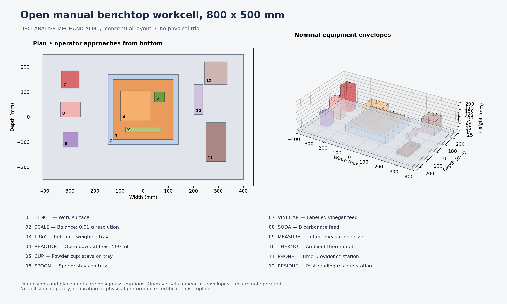

# Chemical process + manual workcell v1

A declarative vinegar–bicarbonate experiment with a linked **800 × 500 mm manual
benchtop workcell**. All equipment is off the shelf; no robot, custom fabrication,
closed gas collector, heater or automated dosing is required.



## Chemical process

CH₃COOH + NaHCO₃ → CH₃COONa + H₂O + CO₂

Nominal inputs are **2.00 g sodium bicarbonate** and **50 mL food vinegar with an
explicit 5 g acetic acid / 100 mL concentration basis**. A bare “5%” label is not
sufficient to establish that basis. The existing stoichiometric evaluator predicts
at most **440095/420033 g ≈ 1.047763 g CO₂** under its declared complete-reaction
assumption. Reaction time, pH, heat release and dissolved gas remain unmodeled.

The product is an aqueous sodium acetate mixture with excess acid, not purified
sodium acetate. This initial cell is a reaction/measurement benchmark, not a
qualified production process.

## Physical arrangement

- Left: labelled stock containers and a 50 mL measuring vessel.
- Center: balance supporting a lightweight tray, an **open bowl ≥500 mL**, a powder
  cup and a spoon. All four objects belong to the before/after weighed boundary.
- Right: ambient thermometer and phone for timer/evidence; residue transfer happens
  only after the final mass reading.

The reaction bowl is open. Its rectangular envelope in the preview is not a lid.
Dimensions are design assumptions, not verified supplier parts or detailed CAD.
Select a balance with **0.01 g resolution**, adequate total-load capacity and a
platform that supports the tray without contact elsewhere. Resolution does not
establish accuracy: record a defensible uncertainty and check calibration.
No prices or supplier availability are claimed.

## Existing contracts, composed

`product.json` is a native `forma.product-domains` bundle:

- ChemicalIR owns species, reaction and scientific evidence.
- ProcessIR owns material streams, batch quantities and ordered manual steps.
- MechanicalIR owns equipment identities, dimensions and placements.
- Existing `uses_equipment` links bind operations to equipment; `uses_reaction`
  links the process to the chemical reaction. All endpoints carry revision/hash pins.

`experiment.json` pins the same mechanical artifact alongside the chemistry,
selects `stoichiometric-bound@1.0` and preregisters the criterion.
`plan.json` is its frozen, reproducible prediction. `validation.json` records
contract checks and explicitly unknown physical statuses. `equipment.csv` is an
inventory of assumed equipment envelopes, not a priced procurement BOM.

There is no workcell-specific evaluator or new IR. To author another supported
process, edit the native declarations and their links, regenerate their references
and freeze a new plan. A revised trial must retain its old plan and link the new
plan through the existing refinement fields. The inspector rejects disagreement
between the product, request and frozen plan.

## Manual trial

Follow the full protocol in `plan.json`. In brief:

1. Confirm stock identities, concentration basis, scale capacity and uncertainty.
   Record actual feeds; revise and freeze a new plan before mixing if needed.
2. Weigh the complete tray, bowl containing vinegar, loaded powder cup and spoon.
3. Slowly add the powder into the open bowl. Stir gently, keep the empty powder cup
   and spoon within the tray, avoid splashes, and never seal the vessel.
4. After visible bubbling subsides, record mass one minute apart until consecutive
   readings differ by ≤0.02 g, or stop at 15 minutes and mark incomplete.
5. Submit initial and final mass, elapsed time, ambient temperature, uncertainty,
   instrument resolution, stock-label and balance photographs, and deviations.
   Keep the phone outside the weighed boundary.

The existing ±0.20 g comparison tolerance is a screening choice, not a confidence
interval. Keep spills on record and do not confirm proxy assumptions after material
loss. Stable mass does not prove complete conversion. Ordinary food ingredients
only; avoid eye contact and tasting the experimental mixture. The original process
includes handling and cleanup instructions.

## Reproduce the software checks

```bash
python -m examples.chemical_workcell.inspect_workcell
python -m examples.chemical_workcell.inspect_workcell --render  # optional matplotlib
python -m pytest tests/projects/test_chemical_workcell.py -q
```

The script consumes the declarations and exports a generic placement preview; it
contains no chemical calculations or equipment-ID dispatch. The original request
can also be submitted to the existing empirical REST/MCP prepare interfaces.
No deployment changes are included.

**Physical trials: zero.** Native schema/composition checks establish coherent
references only. Capacity, spill retention, access, instrument accuracy, actual
reaction performance and measured material balance still require physical checks.
This version does not claim industrial applicability or automatic execution.
