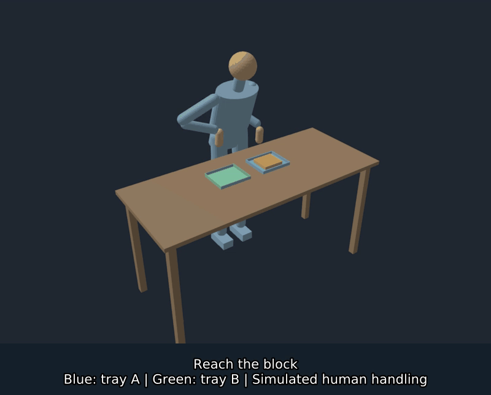

# Human block transfer: round trip



This independent declaration extends the one-way block benchmark to A → B → A:
eight dependent ProcessIR steps, fourteen completed phases, two distinct grasps
and four inventory transitions. Nominal 300 g is conserved throughout; the block
ends supported in tray A after the hand withdraws. It uses the same mannequin
profile as ../rigid-block-transfer/human.json and the unchanged generic runtime.

From the repository root:

```bash
python -m forma_core domains process-runtime examples/process_runtime/human-round-trip/request.json --output /tmp/round-trip-trace.json
python -m pytest tests/projects/test_human_workcell_benchmarks.py -q
```

verification.json and negative-checks.json record the original native execution at
code head dba67ff. The 23.15-second simulated run is displayed over 24 seconds.
The native OpenIndustries renderer exports two 12-second segments; FFmpeg joins
and captions them. Native OpenCAD geometry was reused, not recompiled. The GIF
is a review artifact; the request regenerates execution evidence independently.
The full native scene/render package was delivered separately with the demo.

Valid execution and negative tests are separate: missing return reach, release
above support and omitted interaction declarations must fail for their intended
reasons. A schema rejection is not proof of successful handling.

This verifies sampled simulated relationships and nominal accounting only, not
forces, friction, complete collision freedom, human balance or physical performance.
