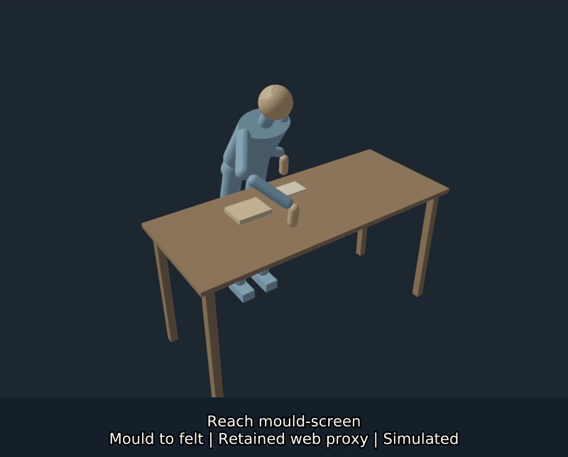

# Mould-to-felt: retained wet-web proxy



Three dependent ProcessIR steps execute eleven phases: reach and grasp the mould,
carry and invert it over felt, release an initially retained sheet proxy onto the
felt, then lift and return the empty mould. The sheet remains on felt. The deckle
has already been removed; this scenario begins after sheet formation.

The existing generic retention/release contract supports this rigid proxy handoff
without new core code. The mould is the releasing actor while held by the human.
Strict source ownership and supported release gate the inventory transaction.

```bash
python -m forma_core domains process-runtime examples/process_runtime/mould-to-felt/request.json --output /tmp/couching-trace.json
python -m pytest tests/projects/test_human_workcell_benchmarks.py -q
```

verification.json and negative-checks.json record the native execution at code head
dba67ff. Runtime: 12.3 simulated seconds; replay: 10.5 seconds plus a 1.5-second
final-state hold. OpenIndustries renders runtime poses using reused OpenCAD meshes.
The original full scene/render package was delivered separately with the demo.
Use ../rigid-block-transfer/human.json for the reused mannequin/operator profile.

The 127 × 177.8 mm proxy transfers 4.51612 g of nominal DRY-cellulose equivalent
(200 g/m²). Wet mass and water are not modeled. The 1.2 mm visual thickness is
illustrative, not specified dry caliper. Zero accounting residual does not prove
actual fiber retention or manufacturing yield.

Negative cases separately check inversion without retention, release 50 mm above
felt, and missing release action. None may credit material to felt.

Unknown: adhesion/release forces, deformation, tearing, water drainage, partial
fiber transfer, drying kinetics, filtration efficiency and saleable quality.
No measured evidence or verified wet-material physics is claimed. This is a
bounded handling rehearsal, not end-to-end papermaking verification.
