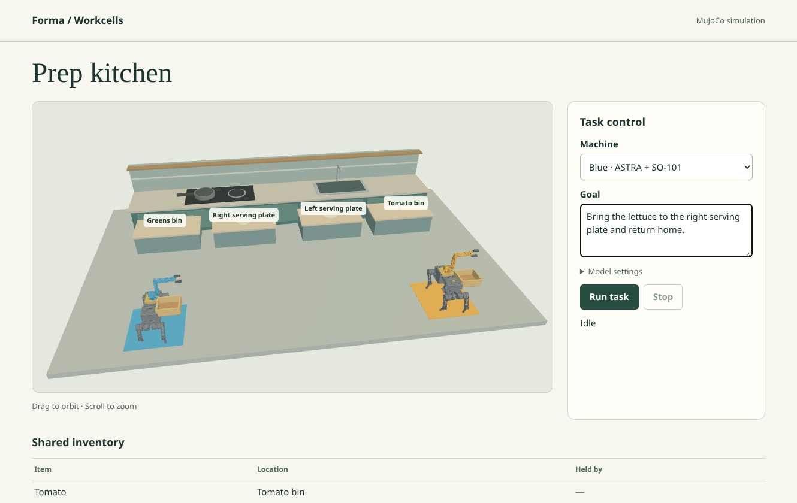

# Two-rover prep kitchen

Amber and Blue are the ASTRA quadruped with the mounted SO-101 arm from the [two-rover garden](https://github.com/isayahc/NYCRoboGarden/tree/6fe75b0cf40cf24e39732a2a1a41341689bed613). This example runs entirely from OpenForma after asset setup. Both machines inhabit one MuJoCo world and accept independent natural-language goals through Control Studio's OpenCode SDK worker. The browser shows their actual simulated geometry, joint poses, item custody, task progress, and execution journals.



## Launch on WSL2 or Linux

From the OpenForma checkout, with Python 3.11+ and npm installed:

```bash
python3 -m venv .venv
source .venv/bin/activate
python -m pip install -e '.[control,robot-sim]' httpx
npm ci --prefix examples/control_studio
python -m forma_core.control.rover_scene.assets examples/rover_kitchen/generated/robots
python -m examples.rover_kitchen.server
```

Open <http://127.0.0.1:8090>. The asset command downloads pinned, licensed models directly from their original repositories. Future launches use the local files. Model calls use your OpenCode provider. Existing Control Studio users can reuse their `.env.task`. For a new installation, use [Control Studio's provider setup](../control_studio/README.md) and set `FORMA_TASK_MODEL=provider/model` in `examples/control_studio/.env.task`, or use the model field in the page. The host loads this file per task. An unauthenticated default model may be rate-limited.

Select Amber, enter **“Serve the tomato on the left plate and return home.”** Start the task. Select Blue and enter **“Bring the lettuce to the right serving plate and park.”** Both can run at once. Each worker discovers its machine package, observes the world, selects actions, and cites evidence from completed runs. Stop freezes the selected machine. The other machine can continue. The inventory shows the item's holder in transit and its station after release.

The run starts with fresh simulated inventory. Task records survive restarts in `generated/run/tasks`. A previous journal is historical evidence. Use a fresh `--output` directory for a distinct demonstration.

## Bring the rovers into another project

Copy [scenario.json](scenario.json), [kitchen.space.json](kitchen.space.json), and the portable [counter fixture](back-counter.xml) to the new project. Keep the installed OpenForma checkout and robot asset cache. From the new project, using the environment where OpenForma was installed:

```bash
python -m forma_core.control.rover_scene \
  --scenario /path/to/new-project/scenario.json \
  --assets /path/to/OpenForma/examples/rover_kitchen/generated/robots \
  --worker /path/to/OpenForma/examples/control_studio/task_worker.mjs \
  --output /path/to/new-project/run --port 8091
```

| File | What to change |
| --- | --- |
| OpenIndustries SpaceIR | Set the room and occupancy polygons in metric world X/Z coordinates. The named occupancies locate counters, the free drive aisle, and home pads. |
| Scenario | Bind machines to home occupancies, stations to counter footprints, and each initial item to a station. Machine IDs, display names, colors, station heights, dock offsets, and inventory are data. |
| OpenForma runtime | Import `forma_core.control.rover_scene` to reuse the model assembly, IK, task scheduling, and feedback contracts. An additional ASTRA/SO-101 instance uses the same profile. A different robot family needs a matching adapter. |

The loader currently supports one open rectangular room with axis-aligned occupancies. The station target is at the footprint center, 32 mm above its surface. Dock offsets are in MuJoCo XY meters, with OI `(x,z)` mapped to MuJoCo `(x,-z)`. Each slot holds one item. IK checks reach at startup. The fleet reserves paths within the clear aisle with 800 mm base separation. The model uses joint-limited kinematics and proximity attachment. Its evidence describes simulated movement and delivery. Arm collisions, contact grasping, cooking, and food transformations require additional models.

## Verification

```bash
python -m unittest -v examples.rover_kitchen.test_workcell
```

The integration suite uses a deterministic test operator through the task API and checks concurrent deliveries, final item positions, independent Stop, and a relocated station with a renamed machine. Production launches use the existing OpenCode worker. Use `GET /api/capabilities/{machine_id}` to inspect the generated actions and `GET /api/tasks/{task_id}` to inspect actual task evidence.

The rover worker receives the action catalogue and the actions currently allowed by its observed pose and custody. It can request base, tool, and item coordinates before deciding what to do next. The task journal retains the full machine package, observations, and any action rejected by a rover precondition.

The [interactive verification record](verification.json) preserves the operator identity, goals, action run IDs, observed final positions, and custody from a separate Codex-operated run through Forma's task tools.

The [stock SDK execution record](sdk-verification.json) covers a separate run from HTTP task submission through the unmodified OpenCode worker. Work Mode Codex chose each tool call over a loopback OpenAI-compatible connection. Both rovers completed eight actions, parked, and disarmed. The record includes session IDs, action run IDs, the model's evidence citations, and item/base positions checked against the fixture geometry.

### Recheck the recorded deliveries

The [unattended local-model record](local-model-verification.json) contains the two goals, OpenCode provider configuration, llama.cpp arguments, model-file SHA-256, and the run IDs cited by Qwen3-4B-Instruct-2507. Qwen completed both goals twice on CPU through the stock Control Studio worker. The first run used one inference slot and processed the rovers in turn. The second submitted both goals together and used two slots. The record includes the rejected commands that the model recovered from.

The [raw SDK journals](sdk-journals.tar.gz) contain both Qwen runs and the concurrent Codex run. From the repository root, check the recorded simulated poses and custody directly against SpaceIR, without installing MuJoCo or calling a provider:

```bash
kitchen=examples/rover_kitchen
receipts="$kitchen/generated/receipts"
mkdir -p "$receipts"
tar -xzf "$kitchen/sdk-journals.tar.gz" -C "$receipts"
python "$kitchen/verify_delivery.py" \
  --delivery "$receipts/local-qwen/amber.json" tomato left_plate \
  --delivery "$receipts/local-qwen/blue.json" lettuce right_plate
python "$kitchen/verify_delivery.py" --require-overlap \
  --delivery "$receipts/concurrent-qwen/amber.json" tomato left_plate \
  --delivery "$receipts/concurrent-qwen/blue.json" lettuce right_plate
```

For a fresh run with your local model server, start llama.cpp with the model and either set of server arguments recorded in the local-model record, substituting your GGUF path for `MODEL.gguf`. With the standard launch dependencies and `jq` installed, start the kitchen in another terminal:

```bash
kitchen=examples/rover_kitchen
mkdir -p "$kitchen/generated"
jq '.provider_config' "$kitchen/local-model-verification.json" > "$kitchen/generated/opencode.json"
OPENCODE_CONFIG="$PWD/$kitchen/generated/opencode.json" \
  FORMA_TASK_MODEL=workcell-local/qwen3-4b-instruct python -m examples.rover_kitchen.server
```

### Model provenance

The assembly and route handling derive from the linked garden revision. The asset installer retains ASTRA's upstream MIT license and the SO-101 model's included Apache-2.0 license. No garden checkout is required to install or run the sample.

### Shared-world execution contract

Scene-specific IDs, placement, station membership, initial inventory and instance
counts are scenario/SpaceIR data. The `astra-so101` profile owns robot-specific
geometry, joints, IK and proximity-transfer implementation. Its supported
`profile_version` is `1` (also the default for existing scenarios). A different
robot family requires an implemented adapter/profile and conformance tests;
renaming an asset or adding a profile string does not make it compatible.

The scene loader validates item/station and occupancy references before building
the model. Installed `REVISION` files must match the robot revisions pinned by
`forma_core.control.rover_scene.assets`. These markers check declared compatibility,
not file integrity; locally modified meshes are not authenticated by the markers.

Scenarios and `POST /api/tasks` accept an optional execution requirement:

```json
"execution": {
  "fidelity": "kinematic",
  "capabilities": ["mobile-base", "arm-positioning", "proximity-transfer"]
}
```

Omitting it preserves the existing kinematic behavior. A request for
`contact-dynamics` or an unsupported capability fails explicitly (HTTP 409 for
tasks), before a worker starts or a machine is armed. This backend does not step
contact physics. Successful transfers establish simulated proximity custody,
not evidence of friction, contact force or physical grasp stability.

`GET /api/scene` and `GET /api/capabilities/{machine_id}` expose the actual
`execution` contract, including evidence kind and declared asset revisions.
Capabilities also expose `profile`, `profile_version` and `bindings`, mapping
each action ID to an `operation` and `target_id`. Discover these bindings rather
than assembling action IDs from scene names. The OpenCode inspection view exposes
the same bindings. Observations and persisted task observations carry execution
metadata; the viewer displays the simulation fidelity and attachment semantics.

One `Scene` owns model/data, inventory and custody for all instances. Custody
transitions are serialized on the host event loop: an item has one holder, a rover
holds at most one item, and release cannot overwrite an occupied station. These
methods are not a thread-safe distributed state store. The host remains the sole
writer; OI and viewers consume its state rather than maintaining a second runtime.

Run the regression and portability checks after installing the pinned assets:

```bash
python -m forma_core.control.rover_scene.assets examples/rover_kitchen/generated/robots
python -m unittest -v examples.rover_kitchen.test_workcell tests.control.test_rover_scene
```

The portability test renames all machine, station, item, occupancy and region IDs,
translates the complete world, reverses machine order and adds a third rover using
only input data. Two tasks discover action bindings through HTTP, transfer items
concurrently and retain independent evidence while the third rover remains idle.
Additional checks reject incompatible requirements/references/revisions, duplicate
adapter registration and conflicting custody writes. CI installs assets before
running these tests on Linux so the integration checks are not silently skipped.
